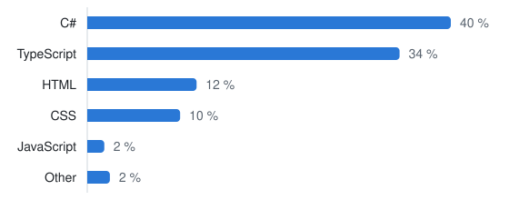

# Marek Dvořáček

.NET developer from the Czech Republic. I build web apps end to end: an ASP.NET Core backend, PostgreSQL, a TypeScript frontend, and the Docker and CI/CD setup to run them on a server I look after myself.

I also make music, from acoustic and electric guitars and bass to techno and liquid, and that is where most of my side projects come from.

## Now

**[KeyChordFinder](https://keychordfinder.com)** is a free web app for musicians: find the chords in a scale, build chord progressions and export them to MIDI, train your ear, tune an instrument. It runs on my own VPS behind Caddy with automatic HTTPS, deploys itself from GitHub Actions on every merge, and was built together with Claude Code.

## Selected work

| Project | What it is | Built with |
| --- | --- | --- |
| [BattleShips](https://github.com/Marcus0035/BattleShips) | Backend of a Battleships game: ship placement, turns, hit and sunk logic, tests | .NET 8, EF Core, SQL Server, Docker |
| [FlChecker](https://github.com/Marcus0035/FlChecker) | Watches the FL Studio price and emails me when it drops | .NET 9, Playwright, Docker |
| [KeyChordFinderMaui](https://github.com/Marcus0035/KeyChordFinderMaui) | The first version of KeyChordFinder as a cross-platform app | .NET MAUI Blazor, SQLite |
| [PlatiKrab](https://github.com/Marcus0035/PlatiKrab) | Training attendance and who pays for the hall, with QR codes for the transfers | Blazor, MAUI, SQLite |
| [OrderManagement](https://github.com/Marcus0035/OrderManagement) | Order system with customers and products, meant as a template | .NET 6, Blazor, EF Core |

More in the [portfolio](https://github.com/Marcus0035/Portfolio).

## What I work with

**Backend** C#, ASP.NET Core, EF Core, xUnit  
**Data** PostgreSQL, SQL Server, SQLite, Redis  
**Frontend** TypeScript, Blazor, HTML and CSS  
**Running it** Docker, Docker Compose, Caddy, GitHub Actions, Linux

<picture>
  <source media="(prefers-color-scheme: dark)" srcset="assets/languages-dark.svg">
  
</picture>

Share of code by language across all my repositories, public and private (October 2026). Refresh it with <code>python3 scripts/update-languages.py</code>.
